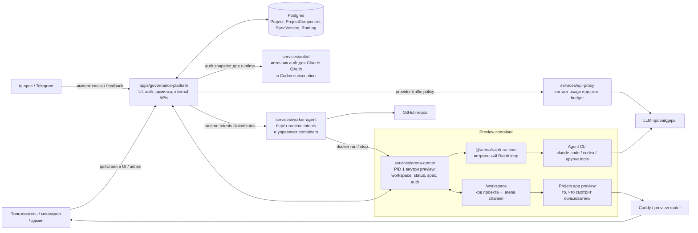
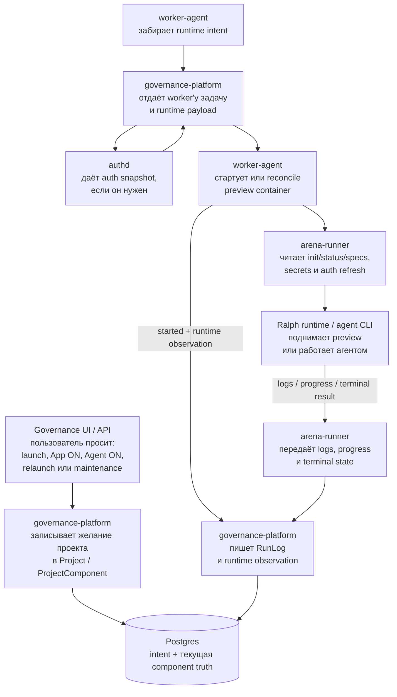
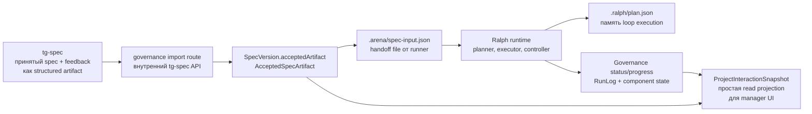
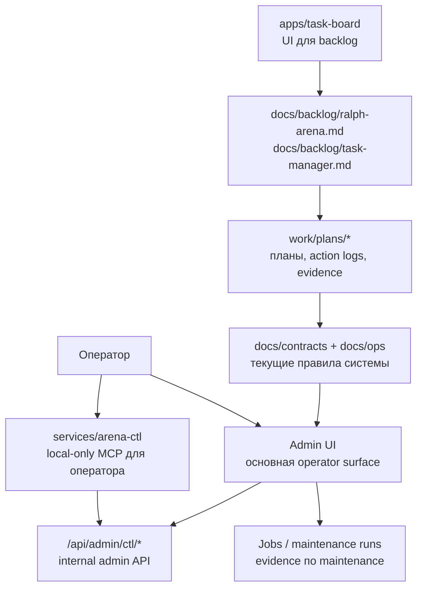

# Карта структуры Ralph Arena

Это поддерживаемая repo-side блок-схема для `agents-arena`.

Файл нужен как навигационная карта для агентов и операторов. Это не новый
источник истины. Если карта расходится с кодом или каноническим контрактом,
правда за кодом/контрактом, а этот файл нужно обновить.

Внешние диаграммы, включая Miro-доску через MCP, могут зеркалить этот файл.
Они не должны становиться владельцем runtime, product, lifecycle или operator
truth.

## Контракт

- Канонические платформенные контракты живут в `docs/contracts/` и `docs/ops/`.
- Каноническая ownership-карта кода живет в `apps/`, `services/` и `packages/`.
- Эта карта только называет boundary, потоки и точки операторской проверки.
- Не добавляй сюда states, fallback paths, lifecycle vocabulary или product
  semantics, которых нет в канонических контрактах.

## Search hygiene

При repo-wide поиске отделяй current truth от snapshots:

- current surfaces: `AGENTS.md`, `CLAUDE.md`, `.codex/**`, `.claude/**`,
  `docs/**`, `apps/**`, `services/**`, `packages/**`, `scripts/**`;
- historical/work surfaces: `docs/backlog/**`, `work/**`;
- ignored runtime/build snapshots: `.claude/worktrees/**`, `runtime/**`,
  `node_modules/**`, `.next/**`, `dist/**`, `build/**`, `coverage/**`.

Если finding найден только в ignored snapshot, не переносить его в вывод как
актуальный drift без live evidence из current surfaces.

## Верхнеуровневые плоскости



## Runtime claim flow



## Product truth flow



Важные ownership-заметки:

- `AcceptedSpecArtifact` — product truth для accepted spec, accepted diff,
  feedback, assumptions, safe secret refs и asset refs.
- `.ralph/plan.json` — loop execution memory, не публичная product truth.
- `ProjectInteractionSnapshot` — read-side projection для product surfaces,
  не отдельное product-хранилище.
- `RunLog`, prompt traces, Langfuse mirrors и maintenance runs — telemetry или
  evidence. Они не lifecycle owners.

## Карта операторских поверхностей



Операторские правила:

- Начинай lifecycle/runtime диагностику с admin UI/API или `arena-ctl`, а не с
  raw SQL или one-off scripts.
- Используй `project_explain` и `fleet_summary`, когда вопрос про project или
  fleet truth.
- Если повторяющийся операторский вопрос требует raw inspection, добавь или
  сузь явный operator tool вместо того, чтобы полагаться на эту карту.

## Быстрая карта ownership в репе

| Path | Владеет | Не владеет |
|---|---|---|
| `apps/governance-platform/` | UI, auth, admin actions, internal APIs, project/spec/component persistence | Direct Docker runtime execution |
| `services/worker-agent/` | Runtime-intent claims, Docker preview container start/stop/reconcile | Product/spec interpretation |
| `services/arena-runner/` | Preview container PID 1, workspace prep, status/spec/auth sync, loop command launch | Ralph-specific planning logic |
| `services/api-proxy/` | Provider proxying, usage accounting, budget enforcement | Auth source of truth |
| `services/authd/` | Local Claude OAuth and Codex subscription runtime auth authority | Project secrets или API-key policy |
| `services/arena-ctl/` | Local-only operator MCP/admin tools over governance truth | Public API или alternate lifecycle owner |
| `packages/contracts/` | Shared strict schemas, включая `AcceptedSpecArtifact` | UI-local projections |
| `packages/loops/ralph-runtime/` | Bundled first-party loop runtime and prompt/agent logic | Governance lifecycle truth |
| `apps/task-board/` | Backlog UI over markdown backlog files | Runtime status |
| `apps/a2e-studio/` | A2E operator/test studio | Core lifecycle ownership |
| `docs/` | Current supported contracts and operator docs | Historical campaign logs |
| `work/` | Plans, audits, evidence, handoff logs | Current platform contract by default |

## Checklist обновления

Используй этот checklist, когда меняешь карту или зеркалишь её во внешнюю
диаграмму:

1. Перечитай релевантные contract docs перед правкой.
2. Проверь затронутые code paths через `rg` или прямое чтение source.
3. Держи этот файл projection от текущих code/contracts.
4. Обновляй diagrams и quick map вместе, если ownership boundary переехал.
5. Не добавляй diagram-only states, verbs, fields или fallback behavior.
6. Если репа изменилась, а карта нет, запиши причину в task log.

Минимальная проверка для docs-only edits:

```bash
./scripts/docker-local-stack.sh exec -T governance-platform npm run backlog:check
git diff --check
```
